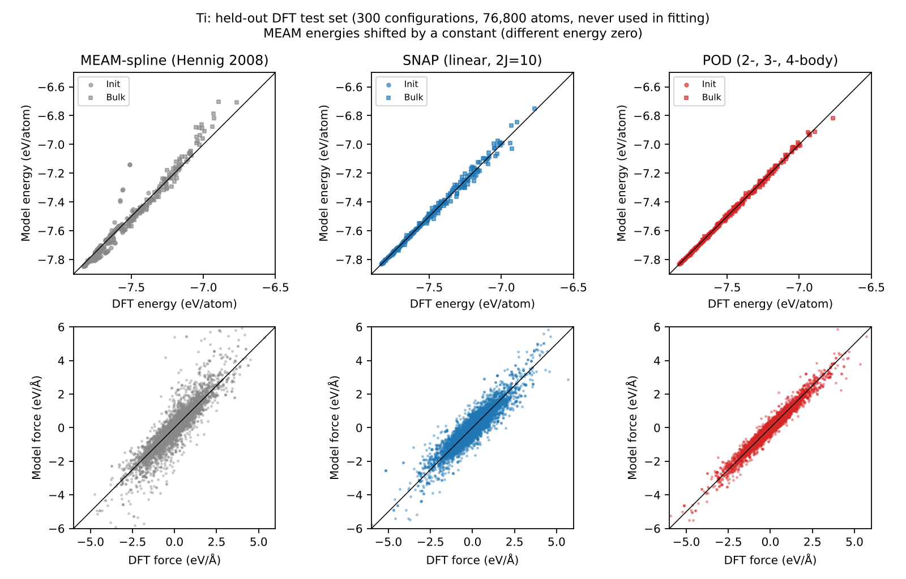
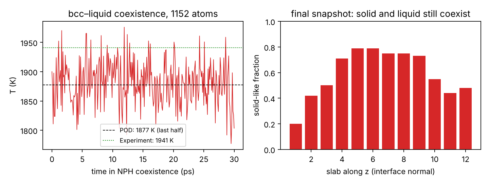

# Machine-learned interatomic potentials for titanium: fitting, validation and melting

**Ilemona S. Omeje** · [github.com/Omejeilemona](https://github.com/Omejeilemona)

This repository fits machine-learned interatomic potentials (MLIPs) for titanium to public DFT data, tests them on configurations never seen during fitting, and benchmarks them against a widely used classical potential (MEAM-spline, Hennig *et al.*, *Phys. Rev. B* 78, 054121, 2008) on lattice, elastic, phase-stability, defect and melting properties. It also shows how a missing phase (ω-Ti) can be repaired by adding a small set of targeted DFT calculations. All simulations run in LAMMPS.

**Motivation.** Ultrafast laser processing drives titanium through the hcp → bcc transition, into the liquid, and back through rapid solidification. A potential for that regime has to be accurate well beyond the near-equilibrium structures that classical potentials are usually fitted to.

## Contents

| Folder | What is in it |
|---|---|
| `potentials/snap` | Linear SNAP potential (2J = 10) |
| `potentials/pod_v1` | POD potential fitted to the public DFT data |
| `potentials/pod_v2_omega` | POD potential with added ω-Ti DFT data (this work) |
| `data_omega` | New GPAW-PBE calculations: ω-Ti and hcp/bcc/fcc alignment structures |
| `scripts` | Data conversion, fitting, held-out testing, property and melting calculations |
| `inputs` | FitSNAP and LAMMPS `fitpod` input files |
| `results` | Error tables, property files (JSON) and figures |

## Data

- **DFT reference.** 5,704 configurations of 256 Ti atoms (hcp, bcc, fcc) with energies, forces and virials, from Röcken & Zavadlav, *npj Comput. Mater.* 10, 69 (2024), Apache-2.0 ([repository](https://github.com/tummfm/Fused-EXP-DFT-MLP)). The data originate from Wen *et al.*, *npj Comput. Mater.* 7, 206 (2021) (VASP, PBE). "Init" = near-lattice and strained structures (1,469); "Bulk" = finite-temperature MD snapshots up to hot, disordered states (4,235).
- **Split.** 1,500 configurations (600 Init + 900 Bulk) are used for fitting. All errors below are on a **held-out test set of 300 configurations (76,800 atoms)** drawn from the remaining 4,204 and never used in fitting.
- **Check.** Virials were verified against the slope of the DFT energy–volume curve (correlation 0.997) before use.
- **New ω-Ti data (this work).** The reference dataset contains no ω phase. I computed 7 ω-Ti configurations (5 volumes, 2 rattled cells) and hcp/bcc/fcc alignment structures with GPAW (PBE, plane waves 500 eV, Fermi–Dirac 0.1 eV). GPAW energies were shifted by a constant per atom to match the hcp energy of the reference data. The shifted GPAW energy differences agree with the reference data (bcc − hcp 111 vs 105 meV/atom; fcc − hcp 57 vs 52 meV/atom).

## Models

| Model | Descriptors | Training data | Fitting |
|---|---|---|---|
| **SNAP** | Linear bispectrum, 2J = 10, r_cut = 5.0 Å, ZBL core | Reference DFT | FitSNAP (SVD); energy, force and Init stress |
| **POD v1** | 2-, 3- and 4-body proper orthogonal descriptors, r_cut = 5.0 Å | Reference DFT | LAMMPS `fitpod`; energy and force |
| **POD v2** | As POD v1 | Reference DFT + ω-Ti (this work) | As POD v1; ω set weighted ×12 |
| MEAM-spline | Classical reference (Hennig *et al.* 2008) | — | — |

## Results

### 1. Accuracy on held-out DFT data

| Held-out test set | MEAM-spline* | SNAP | **POD v1** | POD v2 |
|---|---|---|---|---|
| Energy RMSE, near-lattice (meV/atom) | 63 | 5.0 | **3.1** | 4.5 |
| Energy RMSE, hot/disordered (meV/atom) | 47 | 26 | **11** | 12 |
| Force RMSE, near-lattice (eV/Å) | 0.060 | 0.030 | 0.021 | **0.019** |
| Force RMSE, hot/disordered (eV/Å) | 0.66 | 0.49 | **0.24** | 0.27 |

\*MEAM energies are compared after removing a constant offset (different energy zero). Force standard deviation in the DFT data: 0.064 eV/Å (near-lattice) and 1.19 eV/Å (hot/disordered).



### 2. Material properties

| Property | MEAM-spline | SNAP | POD v1 | **POD v2** | Reference |
|---|---|---|---|---|---|
| hcp a (Å) | 2.931 | 2.952 | 2.940 | 2.928 | 2.951 (exp.) |
| c/a | 1.596 | 1.567 | 1.579 | 1.603 | 1.588 (exp.) |
| C11 (GPa) | 174 | 234 | 166 | 163 | 176 (exp., 4 K) |
| C12 (GPa) | 95 | 89 | 87 | 81 | 87 (exp., 4 K) |
| C13 (GPa) | 73 | 91 | 80 | 79 | 68 (exp., 4 K) |
| C33 (GPa) | 189 | 194 | 176 | 200 | 191 (exp., 4 K) |
| C44 (GPa) | 58 | 51 | 48 | 57 | 51 (exp., 4 K) |
| E(bcc) − E(hcp) (meV/atom) | 111 | 106 | 105 | 109 | 111 (GPAW, this work) |
| E(fcc) − E(hcp) (meV/atom) | 39 | 54 | 52 | 54 | 57 (GPAW, this work) |
| **E(ω) − E(hcp) (meV/atom)** | −5 | +123 | +55 | **−1.7** | **−4 (GPAW, this work)** |
| Vacancy formation (eV) | 2.19 | 1.78 | 2.08 | 2.43 | ≈ 2.0 (DFT)† |
| Melting point (K) | not converged‡ | not run | **1877 ± 9** | running | 1941 (exp.) |

Experimental elastic constants are those provided with the dataset (4 K). †Approximate literature DFT value; see Hennig *et al.* 2008. ‡The MEAM coexistence run recrystallised; it needs a longer run with a larger liquid fraction.

### 3. Melting point (POD v1)

Solid (bcc)–liquid coexistence in the NPH ensemble (1,152 atoms, 30 ps). The final snapshot still contains both phases (ten Wolde Q6 bond-order analysis), so the mean temperature is a valid estimate of the melting point: **1877 ± 9 K**, 3% below experiment.



## Findings

1. **Body order matters more than descriptor count.** Moving from linear SNAP to 4-body POD halved the energy and force errors on hot, disordered structures. It also brought C11, C12 and C44 within 6% of experiment, even without stress data in the POD fit (C13 and C33 remain 8–18% off).
2. **A potential is only as good as its training data.** Both MLIPs fitted to the reference data predict ω-Ti far above hcp (+55 to +123 meV/atom), whereas DFT puts it slightly below (−4 meV/atom). The dataset contains no ω structures.
3. **Targeted data fixes it, at a price.** Adding just 7 small ω-Ti DFT calculations (POD v2) corrects the ω–hcp ordering (+55 → −1.7 meV/atom) while keeping held-out errors within about 10% of POD v1. It also shifts c/a, C33 and the vacancy energy, which shows that a handful of extra structures is not enough to balance the fit. Systematic active learning (ω, vacancies, surfaces, liquid) is the next step.
4. **POD is the practical choice for large simulations.** It is more accurate than the 2J = 10 SNAP model here and about 20× faster.

**Which potential to use:** POD v1 for bulk hcp/bcc/liquid properties, POD v2 where the ω phase matters (for example high-pressure or β-quenched Ti). Both are demonstration potentials; check them against your target properties before production use.

## Reproduce

```bash
./get_data.sh                                            # download reference DFT data
python scripts/convert.py data/dft/261022_AllInitAndBulk_256atoms_with_types_curatedData fit/XYZ 600 900
python scripts/make_testset.py                           # 300 held-out configurations
# SNAP (FitSNAP + LAMMPS with ML-SNAP):
python -m fitsnap3 inputs/Ti-snap.in
# POD v1 (LAMMPS with ML-POD):
lmp -in inputs/in.fitpod
# POD v2: add the aligned omega data, then refit
python scripts/add_omega.py 12 && lmp -in inputs/in.fitpod
# Tests
python scripts/heldout.py pod potentials/pod_v1 150 results/heldout_pod.npz
python scripts/props.py  pod potentials/pod_v1          # lattice, elastic, phase energies, vacancy
python scripts/melt.py   pod potentials/pod_v1 melt_pod 6 6 16 1900
python scripts/q6.py     melt_pod_final.dump             # check solid-liquid coexistence
# New DFT (GPAW)
python scripts/gpaw_omega.py
```

Tested with LAMMPS 22 Jul 2025 (Python module), FitSNAP (GitHub, Oct 2026) and GPAW 26.7.

## Using the potentials in LAMMPS

```
# POD (v1 or v2)
pair_style pod
pair_coeff * * Ti_param.pod Ti_coefficients.pod Ti

# SNAP
pair_style hybrid/overlay zbl 1.8 2.3 snap
pair_coeff * * zbl 22 22
pair_coeff * * snap Ti_snap.snapcoeff Ti_snap.snapparam Ti
```

## References

- Röcken, S. & Zavadlav, J. *npj Comput. Mater.* 10, 69 (2024): DFT dataset.
- Wen, T. *et al.* *npj Comput. Mater.* 7, 206 (2021): original Ti DFT data.
- Thompson, A. P. *et al.* *J. Comput. Phys.* 285, 316 (2015): SNAP. FitSNAP: github.com/FitSNAP/FitSNAP.
- Nguyen, N.-C. & Rohskopf, A. *J. Comput. Phys.* 480, 112030 (2023): POD.
- Hennig, R. G. *et al.* *Phys. Rev. B* 78, 054121 (2008): MEAM-spline Ti.
- Mortensen, J. J. *et al.* *J. Chem. Phys.* 160, 092503 (2024): GPAW.
- ten Wolde, P. R., Ruiz-Montero, M. J. & Frenkel, D. *J. Chem. Phys.* 104, 9932 (1996): bond-order analysis.
