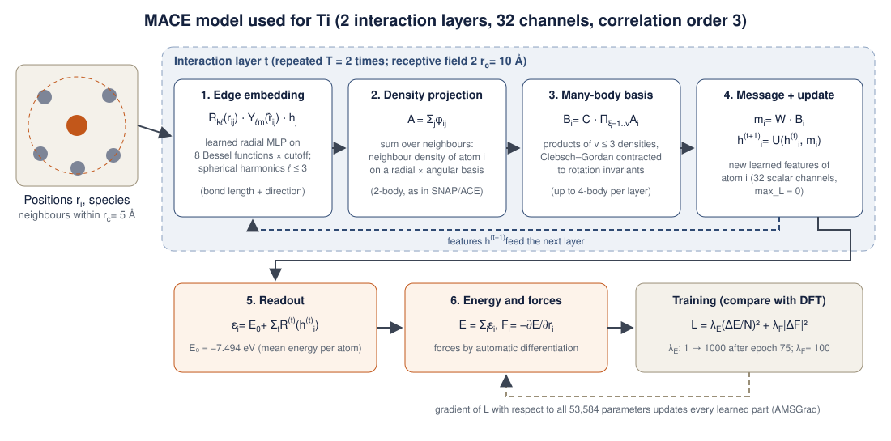

# Machine-learned interatomic potentials for titanium: fitting, validation and melting

**Ilemona S. Omeje** · [github.com/Omejeilemona](https://github.com/Omejeilemona)

This repository fits machine-learned interatomic potentials (MLIPs) for titanium to public DFT data, tests them on configurations never seen during fitting, and compares linear models (SNAP, POD) with an equivariant neural-network potential (MACE), and benchmarks them against a widely used classical potential (MEAM-spline, Hennig *et al.*, *Phys. Rev. B* 78, 054121, 2008) on lattice, elastic, phase-stability, defect and melting properties. It also shows how a missing phase (ω-Ti) can be repaired by adding a small set of targeted DFT calculations. All simulations run in LAMMPS.

**Motivation.** Ultrafast laser processing drives titanium through the hcp → bcc transition, into the liquid, and back through rapid solidification. A potential for that regime has to be accurate well beyond the near-equilibrium structures that classical potentials are usually fitted to.

## Contents

| Folder | What is in it |
|---|---|
| `potentials/snap` | Linear SNAP potential (2J = 10) |
| `potentials/pod_v1` | POD potential fitted to the public DFT data |
| `potentials/pod_v2_omega` | POD potential with added ω-Ti DFT data (this work) |
| `potentials/mace` | MACE neural-network potential (ASE / PyTorch model file) |
| `potentials/pod_v3_partial` | POD refitted with the first 48 configurations of the v3 DFT campaign |
| `dft_v3` | v3 DFT campaign (GPAW): structure generation, job queue, and finished calculations in `done/` |
| `data_mace` | Exact MACE training, validation and test sets (extended XYZ) |
| `data_omega` | New GPAW-PBE calculations: ω-Ti and hcp/bcc/fcc alignment structures |
| `scripts` | Data conversion, fitting, held-out testing, property and melting calculations |
| `inputs` | FitSNAP and LAMMPS `fitpod` input files |
| `results` | Error tables, property files (JSON) and figures |

## Data

- **DFT reference.** 5,704 configurations of 256 Ti atoms (hcp, bcc, fcc) with energies, forces and virials, from Röcken & Zavadlav, *npj Comput. Mater.* 10, 69 (2024), Apache-2.0 ([repository](https://github.com/tummfm/Fused-EXP-DFT-MLP)). The data originate from Wen *et al.*, *npj Comput. Mater.* 7, 206 (2021) (VASP, PBE). "Init" = near-lattice and strained structures (1,469); "Bulk" = finite-temperature MD snapshots up to hot, disordered states (4,235).
- **Split.** 1,500 configurations (600 Init + 900 Bulk) are used for fitting. All errors below are on a **held-out test set of 300 configurations (76,800 atoms)** drawn from the remaining 4,204 and never used in fitting.
- **Check.** Virials were verified against the slope of the DFT energy–volume curve (correlation 0.997) before use.
- **v3 DFT campaign (this work, in progress).** 93 new GPAW-PBE configurations chosen to fill the gaps of the reference data: ω phase (15), the hcp → ω transition path (14), vacancies and interstitials (15), liquid (20), hot solid near melting (16) and surfaces (9), plus 4 alignment cells. Small cells (3–48 atoms) keep each calculation to minutes or a few hours on a laptop. Liquid and hot-solid snapshots come from short MD runs with POD v1. The first 48 (alignment, ω, path, defects) are finished and used in POD v3 (partial) below; the liquid, hot-solid and surface jobs are running.
- **New ω-Ti data (POD v2).** The reference dataset contains no ω phase. I computed 7 ω-Ti configurations (5 volumes, 2 rattled cells) and hcp/bcc/fcc alignment structures with GPAW (PBE, plane waves 500 eV, Fermi–Dirac 0.1 eV). GPAW energies were shifted by a constant per atom to match the hcp energy of the reference data. The shifted GPAW energy differences agree with the reference data (bcc − hcp 111 vs 105 meV/atom; fcc − hcp 57 vs 52 meV/atom).

## Method: the physics and the equations

All three model families (SNAP, POD and MACE) solve the same problem: learn the Born–Oppenheimer potential energy surface $E(\lbrace\mathbf r\rbrace)$ of titanium from DFT, so that molecular dynamics can run with near-DFT accuracy at the cost of a classical potential. What separates them is how much physics is built into the functional form and how much is learned from data.

### Physical constraints built into every model

These are not learned. They are imposed by construction, so the models obey them exactly, even far from the training data.

1. **Locality (nearsightedness of electronic matter).** In a metal, screening makes the energy of an atom depend only on its neighbourhood. The total energy is a sum of atomic energies, each a function of the neighbours within a cutoff $r_c = 5$ Å (the first two neighbour shells of Ti):

```math
E = \sum_{i=1}^{N} \varepsilon_i\big(\lbrace \mathbf r_{ij}\rbrace _{r_{ij}\lt r_c}\big), \qquad \mathbf r_{ij} = \mathbf r_j - \mathbf r_i .
```

   This makes the cost linear in $N$, and lets a model trained on 256-atom cells run on millions of atoms.

2. **Symmetry.** $\varepsilon_i$ is invariant under translation, rotation and reflection (the Euclidean group E(3)) and under exchange of identical atoms. The models never see Cartesian coordinates directly, only descriptors built to be invariant.

3. **Smoothness at the cutoff.** Every neighbour is weighted by a function that goes smoothly to zero at $r_c$, for example
$f_c(r) = \frac{1}{2}\big(1+\cos(\pi r/r_c)\big)$, so energies and forces stay continuous when atoms cross the cutoff sphere.

4. **Energy conservation.** Forces and stress are exact derivatives of the same energy,

```math
\mathbf F_i = -\frac{\partial E}{\partial \mathbf r_i}, \qquad
\sigma_{\alpha\beta} = \frac{1}{V}\sum_i \sum_{j} r_{ij,\alpha}\,\frac{\partial E}{\partial r_{ij,\beta}},
```

   so the force field is conservative and MD conserves the total energy. This also means one model is fitted to energies, forces and virials together: each atom contributes three force components, which is far more data than one energy per cell.

5. **Body-order expansion.** All three models are truncated many-body (cluster) expansions of the atomic energy,

```math
\varepsilon_i = V^{(1)} + \sum_{j} V^{(2)}(\mathbf r_{ij}) + \sum_{j\lt k} V^{(3)}(\mathbf r_{ij},\mathbf r_{ik}) + \sum_{j\lt k\lt l} V^{(4)}(\mathbf r_{ij},\mathbf r_{ik},\mathbf r_{il}) + \dots
```

   The 2-body term carries the pair repulsion and cohesion, the 3-body term the bond angles (what separates hcp, bcc, fcc and ω), and the 4-body term dihedral-like correlations. The models differ in where they truncate and how they parametrise each term.

Together, these conditions fix the form of every model below; the DFT data only determines its parameters. The rest of this section explains what goes into each model and how it is fitted.

### Linear models: SNAP and POD

Both write the atomic energy as a linear combination of descriptors $B_{ik}$, which are fixed functions of the neighbourhood:

```math
\varepsilon_i = c_0 + \sum_{k=1}^{K} c_k\, B_{ik}, \qquad
E = N c_0 + \sum_k c_k \sum_i B_{ik}, \qquad
\mathbf F_j = -\sum_k c_k \sum_i \frac{\partial B_{ik}}{\partial \mathbf r_j}.
```

Energy, forces and stress are all linear in the coefficients $\mathbf c$, so fitting is a weighted linear least-squares problem with a unique solution:

```math
\min_{\mathbf c}\; w_E \sum_{n} \left(\frac{E_n(\mathbf c) - E_n^{\mathrm{DFT}}}{N_n}\right)^2 + w_F \sum_{n}\sum_{i\in n} \big|\mathbf F_i(\mathbf c) - \mathbf F_i^{\mathrm{DFT}}\big|^2
\;\;\Longrightarrow\;\;
\mathbf c = \left(\mathbf A^{\!\top}\mathbf W\mathbf A\right)^{-1}\mathbf A^{\!\top}\mathbf W\,\mathbf y ,
```

where each row of $\mathbf A$ holds the descriptor sums (for an energy) or their derivatives (for a force component), $\mathbf y$ the DFT targets and $\mathbf W$ the weights. POD here uses $w_E = 1000$, $w_F = 1$. In practice the system is solved by SVD or QR rather than by inverting the normal matrix.

**SNAP** (spectral neighbour analysis potential). The neighbour density of atom $i$, $\rho_i(\mathbf r) = \sum_j f_c(r_{ij})\,\delta(\mathbf r - \mathbf r_{ij})$, is mapped onto the 3-sphere and expanded in 4D hyperspherical harmonics $U^{j}_{m,m'}$ (Wigner D-matrices). The expansion coefficients $u^j_{m,m'}$ rotate like angular momenta, so their triple products contracted with Clebsch–Gordan coefficients are rotation invariant: the **bispectrum**

```math
B_{j_1 j_2 j} = \sum_{m,m'} \left(u^{j}_{m,m'}\right)^{*} \sum_{m_1,m_1'}\sum_{m_2,m_2'} C^{j m}_{j_1 m_1 j_2 m_2}\, C^{j m'}_{j_1 m_1' j_2 m_2'}\, u^{j_1}_{m_1,m_1'}\, u^{j_2}_{m_2,m_2'} .
```

With $2J_{\max} = 10$ this gives 91 descriptors, up to 4-body. A Ziegler–Biersack–Littmark (ZBL) screened-Coulomb pair term is added at short range, so atoms that come very close (as in a laser-driven collision cascade) feel the correct nuclear repulsion rather than an extrapolation.

**POD** (proper orthogonal descriptors). The radial functions are not chosen by hand. A family of parametrised functions (spherical Bessel and inverse-power functions over a range of length scales) is sampled, and its principal modes, found by proper orthogonal decomposition (the same technique as principal components or Karhunen–Loève modes), become an orthonormal radial basis $R_k(r)$. Schematically the descriptors are

```math
B^{(2)}_{ik} = \sum_j R_k(r_{ij}), \qquad
B^{(3)}_{ik\ell} = \sum_{j,l} R_k(r_{ij})\,R_k(r_{il})\,\cos^{\ell}\theta_{jil}, \qquad
B^{(4)}_{\dots} \text{ (three angles)},
```

with 8 two-body radial functions, 6 three-body radial functions with angular degree up to 5, and 4 four-body radial functions with angular degree up to 3 (`inputs/Ti_param.pod`). POD keeps the cost and determinism of a linear model but uses a radial basis adapted to the problem.

### Neural network: MACE

In MACE (multi-atomic cluster expansion), the atomic energy is no longer linear in fixed descriptors. Each atom carries learned features $h_{i}^{(t)}$ that are updated by **message passing** between neighbours, and the angular information is carried by spherical harmonics, so every intermediate quantity transforms correctly under rotation (**E(3) equivariance**).



*Figure: the MACE model used here. Steps 1–4 form one interaction layer and are repeated twice; steps 5–6 turn the learned features into the energy and forces, which are compared with DFT during training.*

**Step 1: one-particle basis.** For each neighbour, a learned radial function (a small neural network acting on 8 Bessel functions times $f_c$) is combined with spherical harmonics of the bond direction and the neighbour's features:

```math
\phi_{ij,k\ell m} = R^{(t)}_{k\ell}(r_{ij})\, Y_{\ell}^{m}(\hat{\mathbf r}_{ij}) \sum_{\tilde k} W^{(t)}_{k\tilde k}\, h^{(t)}_{j,\tilde k} .
```

**Step 2: atomic basis (density projection).** Summing over neighbours gives the neighbour density of atom $i$ projected on this basis, exactly as in SNAP and ACE:

```math
A^{(t)}_{i,k\ell m} = \sum_{j\in\mathcal N(i)} \phi_{ij,k\ell m} .
```

**Step 3: many-body basis.** Products of $\nu$ copies of $A$, contracted with generalised Clebsch–Gordan coefficients to the required symmetry $LM$, give $(\nu+1)$-body features at the cost of a single neighbour sum:

```math
B^{(t)}_{i,\eta k L M} = \sum_{\boldsymbol\ell \mathbf m} \mathcal C^{LM}_{\eta,\boldsymbol\ell \mathbf m} \prod_{\xi=1}^{\nu} A^{(t)}_{i,k\ell_\xi m_\xi}, \qquad \nu \le 3 \;(\text{correlation order } 3 \Rightarrow \text{4-body}).
```

**Step 4: message and update.**

```math
m^{(t)}_{i,kLM} = \sum_{\nu}\sum_{\eta} W^{(t)}_{z_i k L,\eta\nu}\, B^{(t)}_{i,\eta k L M}, \qquad
h^{(t+1)}_{i} = U^{(t)}\big(h^{(t)}_{i},\, m^{(t)}_{i}\big),
```

where $U$ is a linear update with a residual connection.

**Step 5: energy readout.**

```math
\varepsilon_i = E_0 + \sum_{t=1}^{T} \mathcal R^{(t)}\big(h^{(t)}_i\big), \qquad E = \sum_i \varepsilon_i ,
```

with a linear readout after the first layer and a small multilayer perceptron after the last. $E_0$ is a fixed per-atom reference energy (here the average energy per atom of the training set, −7.494 eV), so the network only learns the interaction energy. Forces and stress follow from automatic differentiation of $E$, so condition 4 above holds exactly.

**What the settings mean physically.**

| Setting | Value | Meaning |
|---|---|---|
| `r_max` | 5.0 Å | Cutoff per layer (same as SNAP and POD) |
| `num_interactions` | $T = 2$ | Two message-passing layers: the receptive field is $2 r_c = 10$ Å, since information from a neighbour's neighbours reaches atom $i$ |
| `correlation` | $\nu = 3$ | Up to 4-body features in each layer; with two layers the effective body order is much higher |
| `max_L` | 0 | Hidden features are scalars (invariant). Angular information still enters through $Y_\ell^m$ (ℓ ≤ 3) in steps 1–3 before contraction |
| `num_channels` | 32 | Number of learned radial/chemical channels $k$ |

**Loss and training.** The 53,584 parameters $\boldsymbol\theta$ are found by stochastic gradient descent (AMSGrad), not least squares:

```math
\mathcal L(\boldsymbol\theta) = \frac{\lambda_E}{B} \sum_{n=1}^{B} \left(\frac{E_n(\boldsymbol\theta) - E^{\mathrm{DFT}}_n}{N_n}\right)^2 + \frac{\lambda_F}{3\sum_n N_n} \sum_{n=1}^{B}\sum_{i\in n} \big|\mathbf F_i(\boldsymbol\theta) - \mathbf F^{\mathrm{DFT}}_i\big|^2 .
```

Training runs in two stages: $\lambda_E = 1$, $\lambda_F = 100$ for 75 epochs, so the model first learns the shape of the energy surface (its gradients); then $\lambda_E = 1000$ for the last 25 epochs at a lower learning rate, which pins down the absolute energies. An exponential moving average of the weights (decay 0.99) and stochastic weight averaging in stage two smooth the parameters. In the log, the validation energy error falls from about 170 to 22 meV/atom within two epochs of the stage change, and ends at 6.4 meV/atom.

**Linear versus neural network, in one line.** SNAP and POD fix the basis and fit coefficients ($\varepsilon_i = \mathbf c\cdot\mathbf B_i$, convex, unique solution). MACE learns the basis as well ($\varepsilon_i = \mathcal R(h_i(\boldsymbol\theta))$, non-convex, depends on the random seed), which gives more flexibility at higher training and evaluation cost.

### New DFT data and energy alignment

The v3 campaign adds configurations the reference data lacks. All are computed with identical GPAW settings (PBE, plane waves 450 eV, k-point density 5.0 points per Å⁻¹, Γ-centred, Fermi–Dirac smearing 0.1 eV). GPAW and VASP use different pseudopotentials, so total energies differ by a constant per atom. This is removed with one hcp reference cell computed in both:

```math
E^{\mathrm{aligned}}_n = E^{\mathrm{GPAW}}_n + N_n\,\Delta, \qquad
\Delta = \varepsilon^{\mathrm{ref}}_{\mathrm{hcp}} - \varepsilon^{\mathrm{GPAW}}_{\mathrm{hcp}} = -1.194 \text{ eV/atom}.
```

The alignment is checked on energy *differences*, which do not depend on Δ: bcc − hcp and fcc − hcp from GPAW (110 and 57 meV/atom) agree with the reference data as reproduced by POD v1 (105 and 52 meV/atom) within 5 meV/atom. Forces need no correction. Each new category is weighted by repeating it $w_c$ times in the training set, which multiplies its terms in the least-squares loss by $w_c$ (ω × 4, path × 3, defects × 3; liquid and hot solid × 2 and surfaces × 3 once they finish).

## Models

| Model | Descriptors | Training data | Fitting |
|---|---|---|---|
| **SNAP** | Linear bispectrum, 2J = 10, r_cut = 5.0 Å, ZBL core | Reference DFT | FitSNAP (SVD); energy, force and Init stress |
| **POD v1** | 2-, 3- and 4-body proper orthogonal descriptors, r_cut = 5.0 Å | Reference DFT | LAMMPS `fitpod`; energy and force |
| **POD v2** | As POD v1 | Reference DFT + ω-Ti (this work) | As POD v1; ω set weighted ×12 |
| POD v3 (partial) | As POD v1 | Reference DFT + first 48 v3 configurations (ω, path, defects) | As POD v1; copies ω × 4, path × 3, defects × 3 |
| **MACE** | Equivariant message passing: 2 layers, 32 channels, max_L = 0, correlation order 3, r_cut = 5.0 Å | Reference DFT, **400 configurations** (150 Init + 250 Bulk) | `mace_run_train`, 100 epochs on CPU; two-stage loss (forces first, then a higher energy weight for the last 25 epochs, with weight averaging) |
| MEAM-spline | Classical reference (Hennig *et al.* 2008) | — | — |

## Results

### 1. Accuracy on held-out DFT data

| Held-out test set | MEAM-spline* | SNAP | POD v1 | POD v2 | POD v3 (partial) | **MACE** |
|---|---|---|---|---|---|---|
| Energy RMSE, near-lattice (meV/atom) | 63 | 5.0 | **3.1** | 4.5 | 4.1 | 4.3 |
| Energy RMSE, hot/disordered (meV/atom) | 47 | 26 | 11 | 12 | 12 | **10.3** |
| Force RMSE, near-lattice (eV/Å) | 0.060 | 0.030 | 0.021 | 0.019 | 0.019 | **0.014** |
| Force RMSE, hot/disordered (eV/Å) | 0.66 | 0.49 | 0.24 | 0.27 | 0.26 | **0.18** |

\*MEAM energies are compared after removing a constant offset (different energy zero). Force standard deviation in the DFT data: 0.064 eV/Å (near-lattice) and 1.19 eV/Å (hot/disordered). All models are tested on the same 300 configurations. MACE was trained on 400 configurations, against 1,500 for SNAP and POD, because training on a CPU is slow.


### 2. Material properties

| Property | MEAM-spline | SNAP | POD v1 | POD v2 | **POD v3 (partial)** | MACE | Reference |
|---|---|---|---|---|---|---|---|
| hcp a (Å) | 2.931 | 2.952 | 2.940 | 2.928 | 2.930 | 2.924 | 2.951 (exp.) |
| c/a | 1.596 | 1.567 | 1.579 | 1.603 | 1.595 | 1.612 | 1.588 (exp.) |
| C11 (GPa) | 174 | 234 | 166 | 163 | 165 | 164 | 176 (exp., 4 K) |
| C12 (GPa) | 95 | 89 | 87 | 81 | 84 | 74 | 87 (exp., 4 K) |
| C13 (GPa) | 73 | 91 | 80 | 79 | 79 | 51 | 68 (exp., 4 K) |
| C33 (GPa) | 189 | 194 | 176 | 200 | 198 | 209 | 191 (exp., 4 K) |
| C44 (GPa) | 58 | 51 | 48 | 57 | 58 | 55 | 51 (exp., 4 K) |
| E(bcc) − E(hcp) (meV/atom) | 111 | 106 | 105 | 109 | 108 | 104 | 111 (GPAW, this work) |
| E(fcc) − E(hcp) (meV/atom) | 39 | 54 | 52 | 54 | 53 | 57 | 57 (GPAW, this work) |
| **E(ω) − E(hcp) (meV/atom)** | −5 | +123 | +55 | **−1.7** | **−2.7** | +31 | **−4 (GPAW, this work)** |
| Vacancy formation (eV) | 2.19 | 1.78 | 2.08 | 2.43 | 2.19 | 2.37¶ | ≈ 2.0 (DFT)† |
| Melting point (K) | not converged‡ | not run | **1877 ± 9** | ≈ 1870§ | pending | not run | 1941 (exp.) |

Experimental elastic constants are those provided with the dataset (4 K). †Approximate literature DFT value; see Hennig *et al.* 2008. ‡The MEAM coexistence run recrystallised; it needs a longer run with a larger liquid fraction. §POD v2 gave 1869 ± 9 K, but the final snapshot no longer shows a clearly liquid region (solid-like fraction 0.58–0.82 in every slab), so this value is indicative only. ¶MACE properties are computed in ASE with smaller cells (48-atom hcp, 144-atom vacancy cell) to save CPU time; the vacancy value may shift slightly in a larger cell.

### 3. Melting point (POD v1)

Solid (bcc)–liquid coexistence in the NPH ensemble (1,152 atoms, 30 ps). The final snapshot still contains both phases (ten Wolde Q6 bond-order analysis), so the mean temperature is a valid estimate of the melting point: **1877 ± 9 K**, 3% below experiment.


## Findings

1. **Body order matters more than descriptor count.** Moving from linear SNAP to 4-body POD halved the energy and force errors on hot, disordered structures. It also brought C11, C12 and C44 within 6% of experiment, even without stress data in the POD fit (C13 and C33 remain 8–18% off).
2. **A potential is only as good as its training data.** Both MLIPs fitted to the reference data predict ω-Ti far above hcp (+55 to +123 meV/atom), whereas DFT puts it slightly below (−4 meV/atom). The dataset contains no ω structures.
3. **Targeted data fixes it, at a price.** Adding just 7 small ω-Ti DFT calculations (POD v2) corrects the ω–hcp ordering (+55 → −1.7 meV/atom) while keeping held-out errors within about 10% of POD v1. It also shifts c/a, C33 and the vacancy energy, which shows that a handful of extra structures is not enough to balance the fit. Systematic active learning (ω, vacancies, surfaces, liquid) is the next step.
4. **Systematic data beats a handful of structures.** With only the first 48 configurations of the v3 campaign (ω, transition path, defects), POD v3 keeps the correct ω ordering (−2.7 meV/atom, DFT −4) and brings the vacancy energy down from 2.43 eV (v2) to 2.19 eV, and moves c/a closer to experiment (1.595 against 1.603 in v2, 1.588 measured), while held-out errors stay at the v1/v2 level. Liquid, hot-solid and surface data are still being computed; they target the hot-structure force error and the melting point.
5. **The neural network is more accurate where it has data, and just as blind where it has none.** On the same held-out set, MACE cuts force errors by about a third compared with POD v1 (0.014 vs 0.021 eV/Å near-lattice, 0.18 vs 0.24 eV/Å on hot, disordered structures), although it was trained on fewer than a third as many configurations. It also gives the closest fcc − hcp energy. But trained on the same data, which has no ω structures, it also puts ω above hcp (+31 meV/atom), and its C13 and c/a are further from experiment than POD's. Flexibility does not replace missing data: the ω fix still has to come from DFT.
6. **POD is the practical choice for large simulations.** It is more accurate than the 2J = 10 SNAP model here and about 20× faster.

**Which potential to use:** POD v1 for bulk hcp/bcc/liquid properties, POD v2 where the ω phase matters (for example high-pressure or β-quenched Ti), and MACE where force accuracy matters more than speed. A third version (v3), refitted on a larger set of new DFT calculations (ω, transition path, defects, liquid, hot solid, surfaces), is in progress for both POD and MACE. Both are demonstration potentials; check them against your target properties before production use.

## Reproduce

```bash
./get_data.sh                                            # download reference DFT data
python scripts/convert.py data/dft/261022_AllInitAndBulk_256atoms_with_types_curatedData fit/XYZ 600 900
python scripts/make_testset.py                           # 300 held-out configurations
# SNAP (FitSNAP + LAMMPS with ML-SNAP):
python -m fitsnap3 inputs/Ti-snap.in
# POD v1 (LAMMPS with ML-POD):
lmp -in inputs/in.fitpod
# POD v2: add the aligned omega data, then refit
python scripts/add_omega.py 12 && lmp -in inputs/in.fitpod
# Tests
python scripts/heldout.py pod potentials/pod_v1 150 results/heldout_pod.npz
python scripts/props.py  pod potentials/pod_v1          # lattice, elastic, phase energies, vacancy
python scripts/melt.py   pod potentials/pod_v1 melt_pod 6 6 16 1900
python scripts/q6.py     melt_pod_final.dump             # check solid-liquid coexistence
# New DFT (GPAW)
python scripts/gpaw_omega.py
# v3 DFT campaign (GPAW): build the queue, run workers, then refit POD v3
cd dft_v3 && python scripts/gen_structures.py ../potentials/pod_v1 && bash run_dft.sh 2 && cd ..
bash dft_v3/status.sh                                    # progress
python scripts/fit_v3.py                                 # align energies, add copies, fit potentials/pod_v3
# MACE (pip install mace-torch)
python scripts/mace_prepare.py 150 250                   # same split as SNAP/POD -> mace/ (identical to data_mace/)
cd mace && bash ../scripts/run_mace.sh && cd ..           # about 5 h on a CPU; re-run the same command to resume
python scripts/mace_eval.py  mace/mod/ti_mace_stagetwo.model results/heldout_mace
python scripts/mace_props.py mace/mod/ti_mace_stagetwo.model > results/props_mace.json
```

Tested with LAMMPS 22 Jul 2025 (Python module), FitSNAP (GitHub, Oct 2026), GPAW 26.7 and mace-torch (CPU).

## Using the potentials in LAMMPS

```
# POD (v1 or v2)
pair_style pod
pair_coeff * * Ti_param.pod Ti_coefficients.pod Ti

# SNAP
pair_style hybrid/overlay zbl 1.8 2.3 snap
pair_coeff * * zbl 22 22
pair_coeff * * snap Ti_snap.snapcoeff Ti_snap.snapparam Ti
```

MACE is used from Python through ASE:

```python
from mace.calculators import MACECalculator
atoms.calc = MACECalculator(model_paths='potentials/mace/Ti_mace.model', device='cpu')
```

## References

- Röcken, S. & Zavadlav, J. *npj Comput. Mater.* 10, 69 (2024): DFT dataset.
- Wen, T. *et al.* *npj Comput. Mater.* 7, 206 (2021): original Ti DFT data.
- Batatia, I. *et al.* MACE: higher order equivariant message passing neural networks for fast and accurate force fields. *NeurIPS* 35 (2022).
- Thompson, A. P. *et al.* *J. Comput. Phys.* 285, 316 (2015): SNAP. FitSNAP: github.com/FitSNAP/FitSNAP.
- Nguyen, N.-C. & Rohskopf, A. *J. Comput. Phys.* 480, 112030 (2023): POD.
- Hennig, R. G. *et al.* *Phys. Rev. B* 78, 054121 (2008): MEAM-spline Ti.
- Mortensen, J. J. *et al.* *J. Chem. Phys.* 160, 092503 (2024): GPAW.
- ten Wolde, P. R., Ruiz-Montero, M. J. & Frenkel, D. *J. Chem. Phys.* 104, 9932 (1996): bond-order analysis.

## License

Code, potentials and new DFT data in this repository: MIT License (see `LICENSE`). The reference DFT data (downloaded by `get_data.sh`) and the configurations derived from it in `data_mace/` remain under their original Apache-2.0 license (Röcken & Zavadlav 2024; Wen *et al.* 2021).
